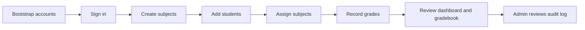

# Scholara — School Management System

A full-stack school management system for **principals, teachers and school staff**. Student
sign-in is intentionally not supported — Scholara is an internal staff workspace.

- **Backend:** Express 5 + PostgreSQL (`pg`), JWT auth, bcrypt, Zod validation, audit logging
- **Frontend:** React 19 + Vite + Tailwind CSS 4, React Router, Lucide icons
- **Roles:** `supadmin`, `admin`, `user` (the user role covers principals, teachers and staff)

## Features

- Role-based access control enforced on the API **and** reflected in the UI
- Student register with admissions, guardians, class placement, search and pagination
- Subjects catalog with enrolment counts and average scores
- Assign subjects to students, choose the responsible teacher, set term/academic year
- Gradebook with filters by class, subject, term and grading status
- Inline grade recording: scores update student averages, class performance and distributions
- Staff directory and account management with principal, admin and super admin privileges
- Complete audit log of sign-ins and record changes
- Change your own profile and password
- Seeded demo school with 14 students, 6 subjects and 48 grades

## Workflow

Scholara is a staff-only workspace. The normal flow is:

1. **Bootstrap access.** A super admin creates admin accounts. Admins and principals add
   teacher and support staff accounts from **Staff & roles**.
2. **Sign in.** Staff sign in with their email and password. Students cannot sign in.
3. **Set up the catalog.** Any signed-in staff member can create the school's subjects.
4. **Admit students.** Staff add students with guardian, class and admission details. The
   admission number is generated automatically (`ADM-YYYY-0001`).
5. **Assign subjects.** Open a student, choose a subject, the responsible teacher, term and
   academic year. A student cannot be assigned the same subject twice in a term.
6. **Record grades.** Open the gradebook and enter or update a score from 0 to 100. Student
   averages, class performance and the dashboard distribution update immediately.
7. **Monitor progress.** The dashboard and gradebook show counts, averages, recent grades and
   class performance. Admins can also review every change in the audit log.
8. **Maintain your account.** Every staff member can update their name and phone and change
   their password from **My profile**.



## Roles & privileges

Scholara has three account roles and three staff positions:

- `supadmin` — system owner with full access, including admin and super admin accounts.
- `admin` — school administrator who manages staff, students, subjects, grades and audit.
- `user` — principal, teacher or support staff. The position changes the label and a few
  principal-only privileges; otherwise the day-to-day access is the same.
- Positions are `principal`, `teacher` and `staff`. Students never receive accounts.

### Privileges by role

| Area | Principal (user) | Teacher / Staff (user) | Admin | Super admin |
| --- | :---: | :---: | :---: | :---: |
| Dashboard, students, subjects, gradebook | View, add, edit | View, add, edit | Full | Full |
| Delete students / subjects | No | No | Yes | Yes |
| Assign / remove subjects, record grades | Yes | Yes | Yes | Yes |
| Clear a recorded grade | No | No | Yes | Yes |
| View the staff directory | Yes | No | Yes | Yes |
| Add teacher / staff accounts | Yes | No | Yes | Yes |
| Edit / delete staff accounts | No | No | Yes | Yes |
| Create / manage admin accounts | No | No | Yes | Yes |
| Create / manage super admin accounts | No | No | No | Yes |
| View the audit log | No | No | Yes | Yes |
| Update own profile and password | Yes | Yes | Yes | Yes |

### Safeguards

- Within the `user` role, only principals can view the staff directory and add accounts.
  Principals can only create `user` accounts with the `teacher` or `staff` position.
- Admins can manage admin and user accounts. Only a super admin can create, edit or delete
  super admin accounts.
- You cannot change your own role, deactivate yourself or delete your own account.
- At least one active super admin must always remain.
- Login attempts are rate limited after 10 failures per 15 minutes.
- Permission keys are enforced on the API; the browser mirrors the same matrix and hides
  unavailable actions.

## Demo data

`npm run db:seed` creates a demo school with 14 students, 6 subjects and 48 grades, plus staff
accounts for each role. These accounts are for local development only; see `server/db/seed.js`
and change the passwords before exposing an environment to anyone else.

## Quick start

Prerequisites: Node.js 20+ and PostgreSQL 14+ (or Docker).

### 1. Start PostgreSQL

The development `.env` expects a database on **port 5433** with user `school`, password
`schoolpass` and database `school_management`. Create it with Docker:

```bash
docker run -d --name school-management-db \
  --restart unless-stopped \
  -e POSTGRES_USER=school \
  -e POSTGRES_PASSWORD=schoolpass \
  -e POSTGRES_DB=school_management \
  -p 5433:5432 \
  -v school_management_pgdata:/var/lib/postgresql/data \
  postgres:16-alpine
```

Or use an existing PostgreSQL server and edit `server/.env` to match. If the Docker container
already exists, just run `docker start school-management-db`.

### 2. Install, migrate and seed

```bash
npm run setup
```

This installs both apps, applies the schema and seeds the demo school. To reseed later:

```bash
npm run db:reset
```

### 3. Run both apps

```bash
npm run dev
```

- Frontend: http://localhost:5173
- API: http://localhost:4000/api (health check at `/api/health`)

You can also run the apps separately with `npm run server` and `npm run client`.

## Project structure

```
.
├── client/                  React + Vite + Tailwind frontend
│   └── src/
│       ├── components/      Layout, modals, forms, UI primitives
│       ├── pages/           Dashboard, Students, Gradebook, Subjects, Staff, Audit, Profile
│       ├── api.js           Fetch wrapper with JWT + 401 handling
│       ├── auth.jsx         Auth context (login, logout, permissions)
│       └── permissions.js   Client mirror of the server permission matrix
├── server/
│   ├── db/                  schema.sql, migrate.js, seed.js
│   └── src/
│       ├── middleware/      JWT auth, permission guard, rate limit, errors
│       ├── routes/          auth, users, students, subjects, enrollments, grades, dashboard, audit
│       ├── lib/             validators, audit helper, academic year, errors
│       ├── db.js            PostgreSQL pool + transactions
│       └── index.js         Express app
└── scripts/dev.js           Runs API + web together
```

## API overview

All routes are prefixed with `/api`. Authenticated routes expect
`Authorization: Bearer <token>`.

| Method | Endpoint | Purpose |
| --- | --- | --- |
| `POST` | `/auth/login` | Sign in, returns JWT + user |
| `GET` | `/auth/me` | Current user |
| `PATCH` | `/auth/me` | Update name/phone |
| `POST` | `/auth/change-password` | Change own password |
| `GET` | `/users` | List staff (principal/admin/supadmin) |
| `GET` | `/users/teachers` | Teacher options for assignment |
| `POST` | `/users` | Add staff (principals: teacher/staff only) |
| `PATCH/DELETE` | `/users/:id` | Edit/delete staff (admin+) |
| `GET` | `/students` | Paginated, searchable register |
| `GET` | `/students/classes` | Class levels with counts |
| `GET` | `/students/:id` | Profile, enrolments, grades, summary |
| `POST/PATCH/DELETE` | `/students/:id?` | Manage students |
| `GET/POST/PATCH/DELETE` | `/subjects` | Subjects catalog |
| `GET/POST/PATCH/DELETE` | `/enrollments` | Subject assignments |
| `PUT` | `/enrollments/:id/grade` | Record/update grade |
| `DELETE` | `/enrollments/:id/grade` | Clear grade (admin+) |
| `GET` | `/grades` | Gradebook with filters |
| `GET` | `/dashboard` | Counts, averages, distribution, activity |
| `GET` | `/audit` | Audit trail (admin+) |

## Database

The schema is idempotent and lives in `server/db/schema.sql`:

- `users` — staff accounts with role, position and activation state
- `students` — admission number generated automatically (`ADM-YYYY-0001`)
- `subjects` — unique subject codes
- `enrollments` — student + subject + teacher + term + academic year (unique per term)
- `grades` — one score per enrolment (0–100), recorded by a staff member
- `audit_logs` — JSON details of every tracked action

Useful commands:

```bash
npm run db:migrate   # apply schema changes
npm run db:seed      # seed only if the database is empty
npm run db:reset     # wipe and reseed demo data
```

## Security notes

- Passwords are hashed with bcrypt (cost 10).
- JWTs expire after 12 hours; sessions are revalidated against the database on each request.
- Helmet and CORS are enabled; JSON bodies are size limited.
- All writes are validated with Zod and recorded in the audit log.
- Before deploying: set a strong `JWT_SECRET`, use HTTPS, restrict `CLIENT_ORIGIN`, and secure
  PostgreSQL credentials. Never commit `server/.env`.
